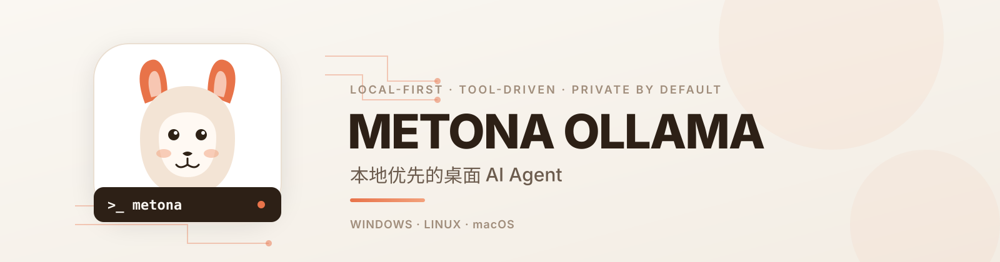
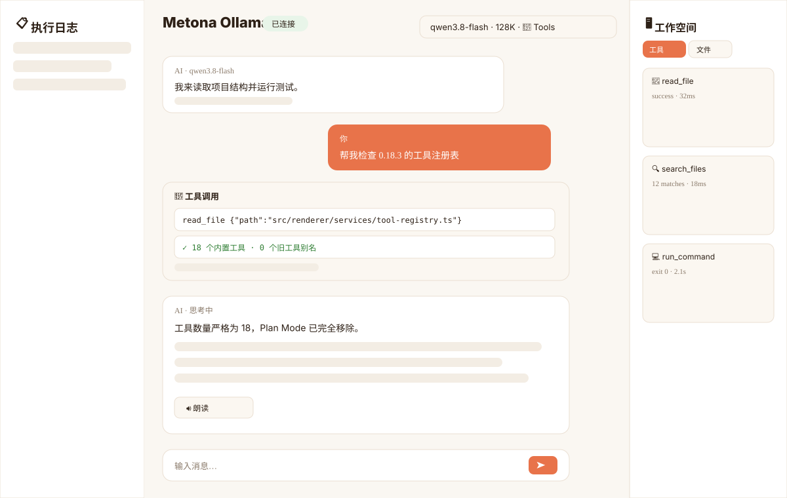
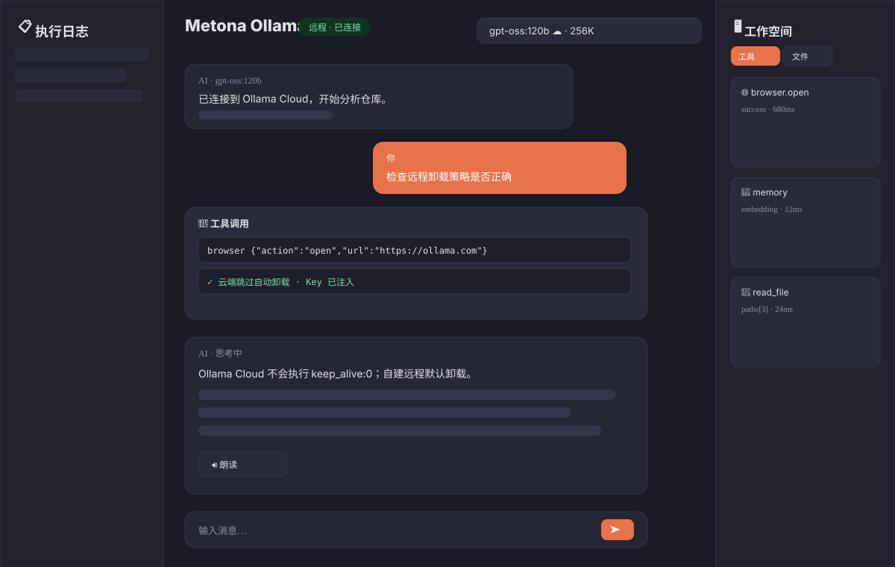
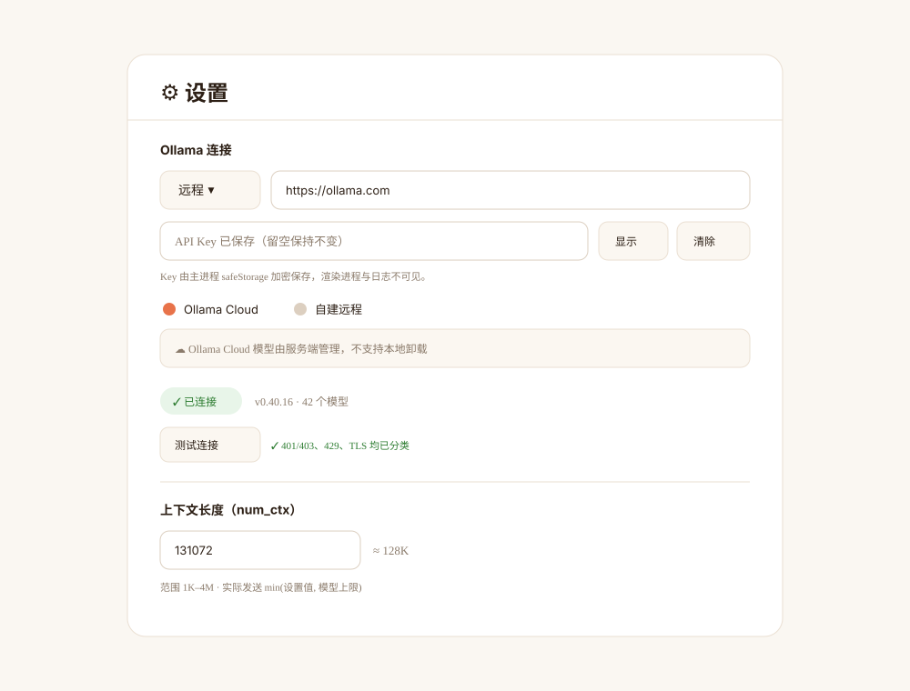
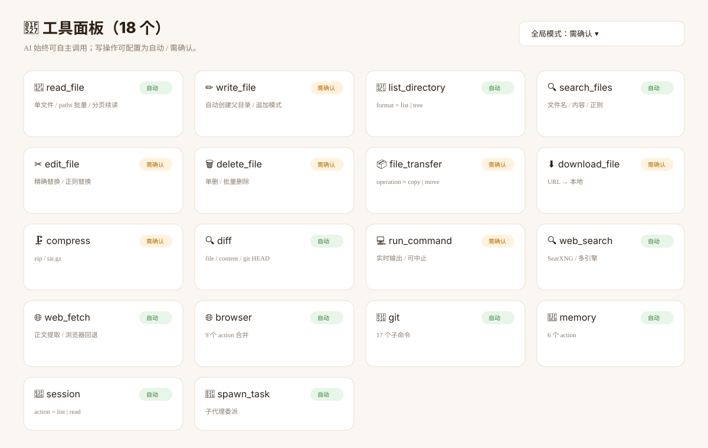
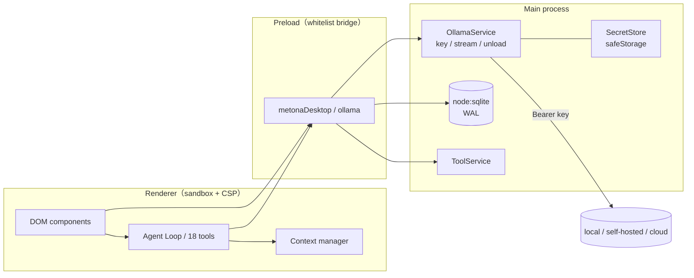

<div align="center">

<picture>
  <source media="(prefers-color-scheme: dark)" srcset="docs/assets/banner-dark.svg">
  <source media="(prefers-color-scheme: light)" srcset="docs/assets/banner-light.svg">
  
</picture>

# Metona Ollama Desktop

**A local-first desktop AI agent: local, self-hosted remote, or Ollama Cloud — with 18 built-in tools and your data kept on your machine.**

[English](README.en.md) · [简体中文](README.md)

[](https://github.com/ThzxxArt/metona-ollama-desktop/releases/latest)
[](https://github.com/ThzxxArt/metona-ollama-desktop/actions/workflows/ci.yml)
[](LICENSE)
[](https://www.electronjs.org/)
[](https://www.typescriptlang.org/)
[](https://ollama.com/)
[](#download)

</div>

---

## Why Metona

| 🏠 Local-first | 🔐 Keys stay in main | 🧰 18 built-in tools | 🧠 Long-term memory |
|---|---|---|---|
| Defaults to `127.0.0.1:11434`; no account, no chat upload | Remote API keys are encrypted with `safeStorage`; the renderer only sees `hasApiKey` | Files, commands, Git, search, browser, sub-agents | Workspace `MEMORY.md` + optional embedding retrieval |
| Works offline; models and history stay local | Ollama API keys never appear in logs, SQLite, or `.metona` backups | Tool panel is generated from the real registry | Keyword/IDF + `/api/embed` cosine similarity |

## Highlights

- **Three connection modes**: local Ollama, self-hosted remote, and Ollama Cloud.
- **Optional API key**: every Ollama endpoint sends `Authorization: Bearer` only when a key is configured.
- **Main-process proxy**: the renderer no longer calls Ollama directly; CORS is gone, `sandbox: true` and CSP are enabled.
- **18 built-in tools**: duplicate capabilities merged to reduce model noise and schema tokens.
- **Plan Mode removed**: no `plan_track`, no plan dialog, no `Ctrl+P`, no hidden branch. The 8-state Agent Loop remains.
- **Manual context length**: default 128K, range 1K–4M, effective value is `min(setting, model limit)`.
- **Remote model unloading**: self-hosted remote unloads on new session/exit by default; Ollama Cloud is skipped; manual unload is available.
- **Ollama 0.40 features**: `done_reason` truncation notice, cached-token metrics, cloud badges, Think levels, structured outputs.
- **Hybrid memory**: keyword/IDF + embedding cosine similarity, cached in `memory_embeddings`, keyword fallback on failure.
- **`.metona` v3 backups**: optional password with PBKDF2 + AES-256-GCM. v1/v2 backups are rejected.
- **Read aloud**: Web Speech API, with an Ollama speech adapter reserved.
- **Update check**: async GitHub Release check; notification only, no silent install.

> [!WARNING]
> **0.18.0 is a breaking release.** It does not read the v0.17.2 `metona.db`, does not import old `.metona` backups, and does not accept old settings keys or old tool names. Back up your original database and sessions before upgrading; you will need to reconfigure the connection.
>
> **0.18.1** keeps the 0.18.0 database and settings format, so it can be installed over 0.18.0. Behavior files now load as a single file: workspace `SOUL.md` first, then `AGENTS.md`, then the built-in `SOUL.md`. The old `AGENT.md` is no longer read; rename it to `AGENTS.md` or `SOUL.md`.

## Screenshots

> The images below are SVG UI illustrations; the running app is the source of truth.

<div align="center">

| Main (light) | Main (dark) |
|---|---|
|  |  |

| Remote settings | 18 tools |
|---|---|
|  |  |

</div>

## Download

Get the latest packages from [Releases](https://github.com/ThzxxArt/metona-ollama-desktop/releases/latest):

| Platform | Artifact | Notes |
|---|---|---|
| Windows x64 | `Metona.Ollama.Setup.v0.18.1.exe` | NSIS; unsigned, SmartScreen may warn |
| Linux x64 | `Metona.Ollama.v0.18.1-x86_64.AppImage` | Portable; `chmod +x` then run |
| Linux x64 | `metona-ollama_0.18.1_amd64.deb` | Debian / Ubuntu |
| macOS x64 | `Metona.Ollama.v0.18.1-mac-x64.zip` | Unsigned, not notarized |
| macOS arm64 | `Metona.Ollama.v0.18.1-mac-arm64.zip` | Apple Silicon |

Each release includes `SHA256SUMS.txt`. On macOS, if Gatekeeper blocks the app:

```bash
xattr -dr com.apple.quarantine "/Applications/Metona Ollama.app"
```

## Quick start

### Local Ollama

```bash
ollama serve
ollama pull qwen3:8b
```

Open Metona → **Settings → Ollama connection → Local → `http://127.0.0.1:11434`**. No API key is needed.

### Self-hosted remote

```bash
OLLAMA_HOST=0.0.0.0:11434 ollama serve
```

1. **Settings → Ollama connection**.
2. Select **Remote**, enter `https://ollama.example.com`.
3. Add an API key if the server requires authentication; leave it empty to send no `Authorization` header.
4. Choose **Self-hosted** and keep “release remote models on new session / exit” if desired.

> Plain `http://` is not encrypted. Prefer HTTPS via a reverse proxy. Unload requests carry the API key and are bounded by a 5-second timeout on exit.

### Ollama Cloud

1. Create an API key at [ollama.com](https://ollama.com).
2. In Metona, select **Remote**, `https://ollama.com`, type **Ollama Cloud**.
3. Enter the key and click **Test connection**.

Cloud models are managed by the server: automatic and manual unloading are both disabled.

## API keys

- Keys live in the main process and are encrypted with Electron `safeStorage`.
- The renderer, DevTools, logs, SQLite, and `.metona` backups never contain the plaintext key.
- No key → no `Authorization` header. With a key, `/api/tags`, `/api/version`, `/api/ps`, `/api/show`, `/api/chat`, `/api/embed`, and `/api/generate` all send `Bearer`.
- When a key is already saved, leaving the field empty keeps it; only **Clear** deletes it.
- If secure storage is unavailable, the key is session-only and the UI says so.

## 18 built-in tools

<details>
<summary><strong>Expand the full tool matrix</strong></summary>

| # | Tool | Description |
|---:|---|---|
| 1 | `read_file` | Single file or `paths` batch (up to 50) |
| 2 | `write_file` | Write/append; creates parent directories |
| 3 | `list_directory` | `format: list \| tree` |
| 4 | `search_files` | Filename/content search, regex supported |
| 5 | `edit_file` | Literal or regex replacement |
| 6 | `delete_file` | Single or batch delete |
| 7 | `file_transfer` | `operation: copy \| move` |
| 8 | `download_file` | Download a URL to disk |
| 9 | `compress` | zip / tar.gz create and extract |
| 10 | `diff` | File vs file / content / git HEAD |
| 11 | `run_command` | Shell command with streaming output |
| 12 | `web_search` | SearXNG / multi-engine search |
| 13 | `web_fetch` | Readable text extraction with browser fallback |
| 14 | `browser` | `action: open/extract/screenshot/click/type/scroll/wait/evaluate/close` |
| 15 | `git` | 17 subcommands |
| 16 | `memory` | search/add/replace/remove/remove_batch/read_all |
| 17 | `session` | `action: list \| read` |
| 18 | `spawn_task` | Sub-agent delegation |

</details>

Removed and no longer accepted: `read_multiple_files`, `create_directory`, `tree`, `copy_file`, `move_file`, all `browser_*` tools, `session_list`, `session_read`, `calculator`, `plan_track`.

## Architecture



See [docs/ARCHITECTURE.md](docs/ARCHITECTURE.md) for details.

## Security

- `contextIsolation: true`, `nodeIntegration: false`, `sandbox: true`.
- CSP with `default-src 'self'`, `script-src 'self'`, `object-src 'none'`, `frame-ancestors 'none'`.
- CORS allowlist removed; the renderer no longer accesses Ollama directly.
- Non-`http/https` `window.open` calls are denied.
- Path sandbox, dangerous-command blocking, SSRF protection, and log redaction.
- `.metona` backups exclude Ollama and SearXNG keys.

See [docs/SECURITY.md](docs/SECURITY.md).

## Development

Requires **Node.js 24+** and npm 12+.

```bash
git clone https://github.com/ThzxxArt/metona-ollama-desktop.git
cd metona-ollama-desktop
npm ci
npm run typecheck
npm test
npm run build
npm start
```

| Command | Purpose |
|---|---|
| `npm run lint` | ESLint |
| `npm run format:check` | Prettier |
| `npm run check:no-temperature` | Guard against sampler regression |
| `npm run test:coverage` | Full-repo coverage (all four ≥85%) |
| `npm run test:e2e` | Playwright Electron E2E |
| `npm run test:e2e:coverage` | Collect E2E V8 coverage |
| `npm run coverage:merge` | Merge unit + E2E coverage and re-check thresholds |
| `npm run dist:win` / `dist:linux` / `dist:mac` | Local packaging |

Stack: Electron 45 · TypeScript 6.0 · Vite 8 · Vitest 5 · `node:sqlite` · zod 4.

## Release

```bash
git tag v0.18.1
git push origin v0.18.1
```

GitHub Actions builds Windows / Linux / macOS artifacts, writes `SHA256SUMS.txt`, and creates the release.

## FAQ

<details>
<summary><strong>Connection errors / 401 / 403</strong></summary>

- 401/403: check the API key and model permissions.
- 404: model missing or wrong path; do not append `/api` (Metona normalizes it).
- 429: rate limited; retry later.
- TLS: check the certificate chain.
- Network: check host, port, firewall, and proxy.
</details>

<details>
<summary><strong>Do I still need OLLAMA_ORIGINS?</strong></summary>

No. All Ollama requests go through the main process; the CORS allowlist was removed.
</details>

<details>
<summary><strong>Why did my sessions disappear after upgrading?</strong></summary>

0.18.0 is breaking and does not read the v0.17.2 `metona.db`. Back up the original database before upgrading; the new version creates a fresh database.
</details>

<details>
<summary><strong>Where is Plan Mode?</strong></summary>

Plan Mode, `plan_track`, the plan dialog, and `Ctrl+P` were fully removed in 0.18.0. The 8-state Agent Loop remains.
</details>

## License

[MIT](LICENSE) © 2026 **ThzxxArt**

<div align="center">
  <sub>Made with ❤️ by <a href="https://github.com/ThzxxArt">ThzxxArt</a></sub>
</div>
