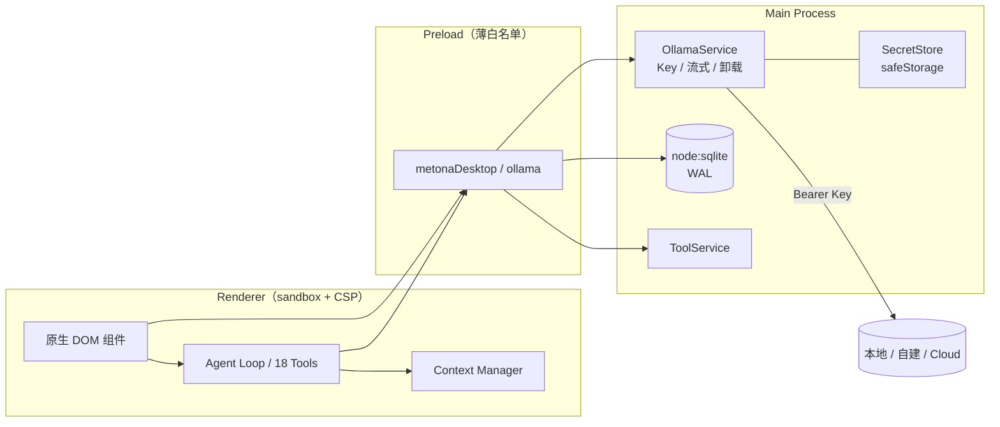

<div align="center">

<picture>
  <source media="(prefers-color-scheme: dark)" srcset="docs/assets/banner-dark.svg">
  <source media="(prefers-color-scheme: light)" srcset="docs/assets/banner-light.svg">
  
</picture>

# Metona Ollama Desktop

**本地优先的桌面 AI Agent：Ollama 本地 / 远程 / Cloud + OpenAI / Anthropic 兼容接口，18 个内置工具，数据留在自己手里。**

[简体中文](README.md) · [English](README.en.md)

[](https://github.com/ThzxxArt/metona-ollama-desktop/releases/latest)
[](https://github.com/ThzxxArt/metona-ollama-desktop/actions/workflows/ci.yml)
[](LICENSE)
[](https://www.electronjs.org/)
[](https://www.typescriptlang.org/)
[](https://ollama.com/)
[](#下载安装)
[](https://github.com/ThzxxArt/metona-ollama-desktop/releases)
[](https://github.com/ThzxxArt/metona-ollama-desktop/stargazers)

</div>

---

## 为什么选择 Metona

| 🏠 本地优先 | 🔐 Key 不出主进程 | 🧰 18 个内置工具 | 🧠 长期记忆 |
|---|---|---|---|
| 默认连接 `127.0.0.1:11434`，不登录、不上传会话 | 远程 API Key 由 `safeStorage` 加密，渲染进程只能看到“是否已配置” | 文件、命令、Git、搜索、浏览器、子代理，覆盖日常开发任务 | 工作空间 `MEMORY.md` + 可选 embedding 语义检索 |
| 离线也能用，模型和聊天记录都在本机 | Ollama API Key 不写入日志、SQLite、`.metona` 备份 | 工具面板与实际注册表同源，不再出现“面板数量与实际不一致” | 关键词 / IDF + `/api/embed` 余弦相似度混合排序 |

## 功能亮点

- **五种连接方式**：Ollama 本地、自建远程、Ollama Cloud、OpenAI Chat Completions 兼容、Anthropic Messages 兼容，设置页一个下拉框切换。
- **第三方 LLM 提供商**：自定义 Base URL、模型名与 API Key；支持流式输出、工具调用、图片输入与用量统计，主进程自动完成 OpenAI / Anthropic 协议转换；兼容 OpenCode Go 的 `x-opencode-session` 会话头。
- **独立加密 Key**：Ollama、OpenAI、Anthropic 的 API Key 分别用 `safeStorage` 加密保存，渲染进程只能看到“是否已配置”。
- **主进程代理**：渲染进程不再直接 `fetch` 任何 LLM，CORS 白名单已删除，`sandbox: true` + CSP 生效。
- **18 个内置工具**：合并重复能力，减少模型选择噪声与 schema token。
- **Plan Mode 已移除**：不再有 `plan_track`、计划确认弹窗、`Ctrl+P` 或隐藏分支；Agent Loop 保持 8 状态机。
- **上下文长度手动输入**：默认 128K，范围 1K–4M，实际发送设置值；模型标称上限仅作参考，可手动超过。
- **最大输出 Token 可调**：默认 4096，范围 256–131072；Ollama 映射 `num_predict`，OpenAI 兼容映射 `max_tokens`（推理模型 `max_completion_tokens`），Anthropic 兼容映射 `max_tokens`。
- **远程模型卸载**：自建远程默认在新建会话/退出时释放；Ollama Cloud 自动跳过；支持手动“释放显存”。
- **Ollama 0.40 能力**：`done_reason` 截断提示、`prompt_eval_cached_count` 缓存命中、云模型徽章、Think 档位、结构化输出。
- **混合记忆检索**：关键词/IDF + embedding 余弦相似度，缓存于 `memory_embeddings` 表，失败自动回退关键词。
- **`.metona` v3 备份**：可选密码，PBKDF2 + AES-256-GCM；旧版 v1/v2 备份不再支持导入。
- **消息朗读**：Web Speech API 本地朗读，预留 Ollama speech 适配。
- **更新检查**：启动后异步检查 GitHub Release，只提示，不静默安装。

> [!WARNING]
> **0.18.0 是破坏性版本**：不读取 v0.17.2 的 `metona.db`，不导入旧 `.metona` 备份，不兼容旧设置键与旧工具名。升级前请自行备份原始数据库与会话；升级后需要重新配置连接。
>
> **0.18.1** 沿用 0.18.0 的数据库与设置格式，可直接覆盖升级。行为文件改为单文件加载：工作空间 `SOUL.md` 优先，其次是 `AGENTS.md`，都没有时使用内置 `SOUL.md`；旧的 `AGENT.md` 不再读取，请重命名为 `AGENTS.md` 或 `SOUL.md`。
>
> **0.18.2** 新增 OpenAI / Anthropic 兼容接口与第三方提供商设置，仍沿用 0.18.x 数据库与设置格式，可直接覆盖升级。

## 界面预览

> 以下为界面示意图（SVG），实际 UI 以运行版本为准。

<div align="center">

| 主界面（浅色） | 主界面（深色） |
|---|---|
|  |  |

| 远程连接设置 | 18 个工具 |
|---|---|
|  |  |

</div>

## 下载安装

前往 [Releases](https://github.com/ThzxxArt/metona-ollama-desktop/releases/latest) 下载最新版本：

| 平台 | 产物 | 说明 |
|---|---|---|
| Windows x64 | `Metona.Ollama.Setup.v0.18.2.exe` | NSIS 安装包；未签名，SmartScreen 可能提示 |
| Linux x64 | `Metona.Ollama.v0.18.2-x86_64.AppImage` | 免安装，`chmod +x` 后运行 |
| Linux x64 | `metona-ollama_0.18.2_amd64.deb` | Debian / Ubuntu 安装包 |
| macOS x64 | `Metona.Ollama.v0.18.2-mac-x64.zip` | 未签名、未公证 |
| macOS arm64 | `Metona.Ollama.v0.18.2-mac-arm64.zip` | Apple Silicon |

每个 Release 附带 `SHA256SUMS.txt`。macOS 首次打开如被拦截，可在“系统设置 → 隐私与安全性”中允许，或执行：

```bash
xattr -dr com.apple.quarantine "/Applications/Metona Ollama.app"
```

## 快速开始

### 1. 本地 Ollama

```bash
# 安装并启动 Ollama
ollama serve
ollama pull qwen3:8b

# 启动 Metona
# 设置 → LLM 连接 → Ollama → 本地 → http://127.0.0.1:11434
```

本地模式不需要 API Key。Metona 默认连接 `http://127.0.0.1:11434`。

### 2. 自建远程 Ollama

```bash
# 在远程服务器上（示例：只监听内网，由反向代理做 TLS）
OLLAMA_HOST=0.0.0.0:11434 ollama serve
```

在 Metona 中：

1. 打开 **设置 → LLM 连接**，提供商选择 **Ollama**。
2. 模式选择 **远程**，地址填写 `https://ollama.example.com`。
3. 如服务端启用了认证，填写 API Key；留空表示不发送 `Authorization`。
4. 选择 **自建远程**，按需保留“新建会话 / 退出时释放远程模型”。

> 远程 `http://` 不会加密传输，建议使用 HTTPS 反向代理。卸载请求会携带 API Key，并在退出时最多等待 5 秒，不阻塞关闭。

### 3. Ollama Cloud

1. 在 [ollama.com](https://ollama.com) 创建 API Key。
2. Metona 设置中选择 **远程**，地址 `https://ollama.com`，类型 **Ollama Cloud**。
3. 填入 API Key 后点击“测试连接”。

云模型由服务端管理，**不会执行自动卸载**，也无法手动释放显存。

### 4. OpenAI / Anthropic 兼容接口

1. 打开 **设置 → LLM 连接**。
2. 提供商选择 **OpenAI 兼容** 或 **Anthropic 兼容**。
3. 填写 Base URL，例如 `https://api.openai.com`、`https://api.deepseek.com`、`https://openrouter.ai/api/v1` 或 `https://api.anthropic.com`。
4. 填写 API Key，点击“测试连接”。
5. 模型列表不可用时，在“模型名称（第三方提供商）”手动填写并点“使用”。

兼容范围：

- OpenAI：`/v1/chat/completions`、`/v1/models`、`/v1/embeddings`，支持 SSE、tools、图片与 usage。
- Anthropic：`/v1/messages`、`/v1/models`，支持 SSE、tool_use、thinking 与 usage；不提供 embeddings，语义记忆自动回退关键词。
- 所有第三方请求由主进程代理，渲染进程与 Agent Loop 只消费统一 chunk。

## 远程连接与 API Key

- Ollama、OpenAI、Anthropic 的 API Key 分别使用 Electron `safeStorage` 加密后写入 `userData`。
- 渲染进程、DevTools、日志、SQLite、`.metona` 备份均不包含明文 Key。
- 未设置 Key 时不发送认证头；Ollama / OpenAI 使用 `Authorization: Bearer`，Anthropic 使用 `x-api-key`（并兼容 `Bearer`）。
- 已保存 Key 时，输入框留空表示保持原值；只有点击“清除”才会删除当前提供商的 Key。
- 系统安全存储不可用时，Key 仅当前会话有效，界面会明确提示。

## 18 个内置工具

<details>
<summary><strong>点击展开完整工具矩阵</strong></summary>

| # | 工具 | 说明 |
|---:|---|---|
| 1 | `read_file` | 单文件读取；`paths` 批量读取（最多 50 个） |
| 2 | `write_file` | 写入/追加；自动创建父目录 |
| 3 | `list_directory` | `format: list \| tree`，列表/树形二合一 |
| 4 | `search_files` | 文件名/内容搜索，支持正则 |
| 5 | `edit_file` | 精确替换 / 正则替换 |
| 6 | `delete_file` | 单删 / 批量删除 |
| 7 | `file_transfer` | `operation: copy \| move` |
| 8 | `download_file` | URL 下载到本地 |
| 9 | `compress` | zip / tar.gz 压缩与解压 |
| 10 | `diff` | 文件 vs 文件 / 内容 / git HEAD |
| 11 | `run_command` | Shell 命令，实时流式输出 |
| 12 | `web_search` | SearXNG / 四引擎搜索 |
| 13 | `web_fetch` | 网页正文提取，必要时回退浏览器 |
| 14 | `browser` | `action: open/extract/screenshot/click/type/scroll/wait/evaluate/close` |
| 15 | `git` | status/log/diff/add/commit/push 等 16 个子命令 |
| 16 | `memory` | search/add/replace/remove/remove_batch/read_all |
| 17 | `session` | `action: list \| read` |
| 18 | `spawn_task` | 子代理委派 |

</details>

已删除且不再接受旧名称：`read_multiple_files`、`create_directory`、`tree`、`copy_file`、`move_file`、`browser_*`（9 个）、`session_list`、`session_read`、`calculator`、`plan_track`。

## 架构



- **渲染进程**：不直接访问 LLM、不读 Node 模块；所有网络与文件能力经 preload 白名单。
- **主进程**：统一 Ollama 代理、`node:sqlite`（WAL）、工具执行、路径/命令/网络/密钥安全。
- **契约层**：`src/shared/contracts` + `src/shared/schemas`，IPC 入参用 zod 校验，并校验发送方。

## 安全与隐私

- `contextIsolation: true`、`nodeIntegration: false`、`sandbox: true`。
- CSP：`default-src 'self'`、`script-src 'self'`、`object-src 'none'`、`frame-ancestors 'none'`。
- 删除 CORS 白名单；渲染进程不再需要跨域访问 Ollama。
- 非 `http/https` 的 `window.open` 一律拒绝。
- 路径沙箱、危险命令拦截、SSRF 防护、日志脱敏（`Authorization` / key / token / password）。
- `.metona` 备份不包含 Ollama Key、SearXNG Key。

更多细节见 [docs/SECURITY.md](docs/SECURITY.md)。

## 开发

要求：**Node.js 24+**、npm 12+。

```bash
git clone https://github.com/ThzxxArt/metona-ollama-desktop.git
cd metona-ollama-desktop
npm ci
npm run typecheck
npm test
npm run build
npm start
```

常用命令：

| 命令 | 作用 |
|---|---|
| `npm run dev:renderer` | Vite 监听构建渲染进程 |
| `npm run dev:main` | TypeScript 监听编译主进程 |
| `npm run lint` | ESLint（TypeScript + tests） |
| `npm run format:check` | Prettier 检查 |
| `npm run check:no-temperature` | 防止 temperature 回归 |
| `npm run test:coverage` | 全仓单测覆盖率（四项 ≥85%） |
| `npm run test:e2e` | Playwright Electron E2E（Linux 需 xvfb） |
| `npm run test:e2e:coverage` | E2E V8 覆盖率采集 |
| `npm run coverage:merge` | 合并单元 + E2E 覆盖率并复核门槛 |
| `npm run dist:win` / `dist:linux` / `dist:mac` | 本地打包 |

技术栈：Electron 45 · TypeScript 6.0 · Vite 8 · Vitest 5 · `node:sqlite` · zod 4。详见 [docs/DEVELOPMENT.md](docs/DEVELOPMENT.md) 与 [docs/ARCHITECTURE.md](docs/ARCHITECTURE.md)。

## 发布

```bash
git tag v0.18.2
git push origin v0.18.2
```

GitHub Actions 会构建 Windows / Linux / macOS 产物，生成 `SHA256SUMS.txt` 并创建 Release。发布流程见 [docs/DEVELOPMENT.md](docs/DEVELOPMENT.md#发布)。

## Roadmap

- **0.19**：TS 7.1 评估、更多 Ollama speech 能力、Provider 配置导入/导出。
- **后续**：可选签名/公证、增量更新、跨设备同步（需单独隐私设计）。

> 0.18.0 已移除 Plan Mode；后续如需“先规划后执行”，将以普通 Agent 提示词策略实现，不再引入并行状态机。

## FAQ

<details>
<summary><strong>连接失败 / 401 / 403 怎么办？</strong></summary>

- 401/403：检查 API Key 是否正确、是否有该模型权限。
- 404：模型不存在或地址路径错误；远程地址不要以 `/api` 结尾（Metona 会自动归一化）。
- 429：请求频率过高，稍后重试。
- TLS：检查证书链；自签名证书需要系统信任。
- 网络：检查地址、端口、防火墙与代理。
</details>

<details>
<summary><strong>还需要设置 OLLAMA_ORIGINS 吗？</strong></summary>

不需要。0.18.0 起所有 LLM 请求由主进程代理，CORS 白名单已删除。
</details>

<details>
<summary><strong>上下文长度填多少？</strong></summary>

默认 131072（128K）。可填 1024–4194304；Metona 会按模型 `context_length` 钳制后发送。云端模型可能忽略 `num_ctx`。
</details>

<details>
<summary><strong>为什么升级后会话不见了？</strong></summary>

0.18.0 是破坏性版本，不读取 v0.17.2 的 `metona.db`。升级前请自行备份原始数据库；新版本会创建全新数据库。
</details>

<details>
<summary><strong>macOS 提示“已损坏”或无法打开？</strong></summary>

产物未签名/未公证。可在“隐私与安全性”中允许，或执行 `xattr -dr com.apple.quarantine "/Applications/Metona Ollama.app"`。
</details>

<details>
<summary><strong>Plan Mode 去哪了？</strong></summary>

0.18.0 已完全移除 Plan Mode、`plan_track`、计划确认弹窗与 `Ctrl+P`。Agent Loop 仍保留 8 状态机。
</details>

## 致谢

- [Ollama](https://ollama.com/) — 本地大模型运行时与 API。
- [Electron](https://www.electronjs.org/)、[Vite](https://vite.dev/)、[Vitest](https://vitest.dev/)、[zod](https://zod.dev/)。
- 所有提交 Issue、反馈与 Star 的用户。

## License

[MIT](LICENSE) © 2026 **ThzxxArt**

<div align="center">
  <sub>Made with ❤️ by <a href="https://github.com/ThzxxArt">ThzxxArt</a></sub>
</div>
