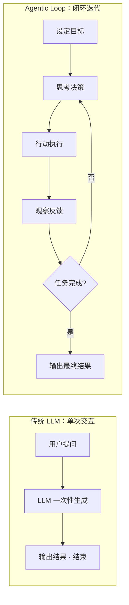
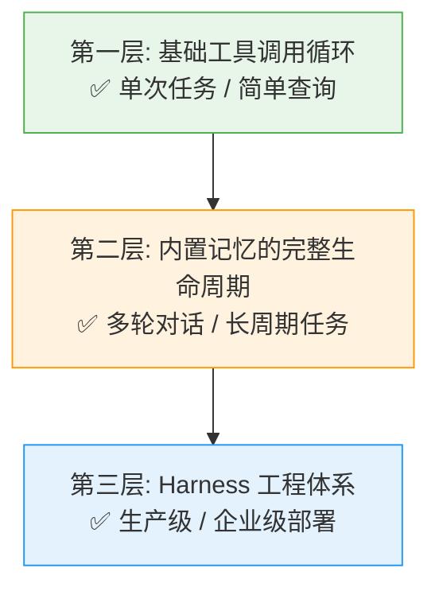
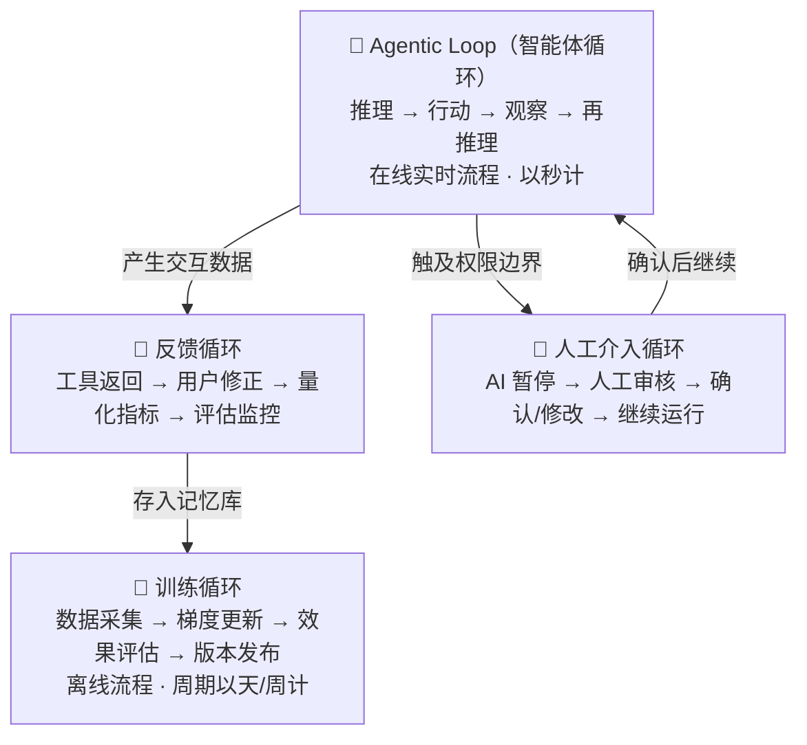

# 🔄 Agentic Loop（智能体循环）完全指南

> **一句话定义**：Agentic Loop 是驱动 AI Agent 持续自主完成复杂任务的核心调度循环——让 AI 不断重复"思考 → 行动 → 观察 → 再思考"的闭环过程，直到任务完成。

---

## 目录

- [一、核心概念](#一核心概念)
- [二、与传统 LLM 的本质区别](#二与传统-llm的本质区别)
- [三、运作机制：五阶闭环详解](#三运作机制五阶闭环详解)
- [四、三层分级体系](#四三层分级体系)
- [五、循环终止条件](#五循环终止条件)
- [六、核心伪代码实现](#六核心伪代码实现)
- [七、与主流 Agent 范式的关系](#七与主流-agent-范式的关系)
- [八、工具调用（Tool Use）六步闭环](#八工具调用tool-use六步闭环)
- [九、适用场景与不适用场景](#九适用场景与不适用场景)
- [十、实际应用案例](#十实际应用案例)
- [十一、关联循环体系](#十一关联循环体系)
- [十二、行业趋势与未来方向](#十二行业趋势与未来方向)
- [十三、参考来源](#十三参考来源)

---

## 一、核心概念

### 什么是 Agentic Loop？

**Agentic Loop（智能体循环）**是 AI Agent 架构中的核心运行机制，它让大语言模型（LLM）从传统的"一问一答"模式升级为能够持续自主地完成复杂任务的闭环系统。

如果把普通 AI 比作「随时待命的客服」，只负责被动应答；那带 Loop 的 AI Agent，就是 **不用催促、自主推进的全职实习生**，懂规划、会试错、能复盘、可收尾。

### 为什么需要它？

传统的 LLM 交互是线性的"一问一答"——用户提问，模型一次性生成回答，交互即结束。一旦任务复杂、变数较多，就会直接"摆烂"，需要人不断细化指令、手动推进进度。

而 **Agentic Loop 引入了「循环」和「反馈」两个关键要素**，使 AI 能够根据中间结果动态调整策略，边执行边验证，而不是死板地执行预设流程。

> 💡 **没有 Agent Loop，AI 只是聊天工具；有了 Agent Loop，AI 才是能落地干活的智能体。**

---

## 二、与传统 LLM 的本质区别

| 维度 | 传统 LLM | Agentic Loop |
|------|----------|--------------|
| **交互方式** | 线性"一问一答" | 循环式"思考→行动→观察" |
| **任务能力** | 单次内容生成 | 持续自主完成复杂任务 |
| **反馈机制** | 无中间反馈 | 基于环境反馈动态调整 |
| **适应性** | 静态输出 | 动态纠错与策略优化 |
| **记忆能力** | 无状态 | 可选配持久化记忆 |
| **工具使用** | 不支持 | 原生支持多工具调用 |



---

## 三、运作机制：五阶闭环详解

Agentic Loop 的完整工作流包含五个阶段，在多数任务中可简化为持续迭代的三步核心循环。

### 完整五阶段

#### ① 目标感知（Perceive）
人类只需给出 **最终目标和核心规则**，不用拆解步骤、不用预设细节。例如：
- "整理一份2026年新媒体行业报告"
- "排查这段代码的运行漏洞并修复"
- "规划一周减脂食谱+运动计划"

这一步彻底告别了过去「精准逐字写提示词」的繁琐。

#### ② 思考决策（Reason）
Agent 结合自身知识库、记忆体系和工具能力，把大目标拆成可落地的小步骤，同时判断：
- 下一步该做什么？
- 需要调用什么工具？
- 优先执行哪项任务？

> **核心区别：步骤不是人定的，是 AI 自己推理出来的。**

#### ③ 行动执行（Act）
根据决策结果执行具体动作：
- 🔍 联网搜索信息
- 💻 调用代码工具 / 执行 Shell 命令
- 📄 读取本地文件
- ✍️ 生成文案内容
- 📊 批量处理数据

这是 AI 从「只会输出文字」到「可以真实做事」的关键一步。

#### ④ 观察反馈（Observe）
Agent 会主动感知执行后的真实状态：
- 搜索的信息是否全面？
- 代码是否运行成功？
- 生成的内容是否缺漏？
- 数据是否存在异常？

它不再盲目输出，而是 **能看见自己的执行结果**。

#### ⑤ 复盘修正（Reflect/Correct）
这是 Loop 最核心的灵魂。Agent 会自我校验：
- 当前结果是否达标？
- 有没有遗漏步骤？
- 有没有错误漏洞？
- 是否需要调整方法？

如果不满足终止条件，立刻修正策略、重启下一轮循环；如果达标，才终止任务、输出最终结果。

### 核心三步简化版

在实际工程中，五阶段常被精简为最核心的三步循环：

```
┌─────────────────────────────────────────────┐
│                                             │
│   ┌──────────┐    ┌──────────┐    ┌────────┐│
│   │ 推理     │──▶│ 行动     │──▶│ 观察   ││
│   │ Reasoning│    │ Acting   │    │Observ. ││
│   └──────────┘    └──────────┘    └────────┘│
│         ▲                              │     │
│         └──────────────────────────────┘     │
│            未完成则继续循环                    │
└─────────────────────────────────────────────┘
```

> **简单总结：思考 → 行动 → 观察 → 评估 → 修正，往复循环，闭环落地。**

---

## 四、三层分级体系

Agentic Loop 不是固定模板，随着记忆存储、工具管理、配套功能完善，可分为三个层级。开发中遇到的绝大多数问题——AI 重复执行相同操作、遗忘前文对话、多轮回答前后逻辑矛盾——根源基本都是 **任务复杂度与智能体层级不匹配**。

### 第一层：基础工具调用循环

**最简形态**，仅依靠大模型调用工具并输出回答，没有持久化记忆、没有外部状态存储。

```
用户输入 → LLM 推理 → 调用工具 → 观察结果 → 回传 LLM → 输出最终答案
```

**特点：**
- ✅ 处理独立、简短的一次性任务完全够用
- ❌ 无法留存历史对话，每次启动都是全新空白状态
- ❌ 上下文窗口是唯一临时存储载体，流程结束后所有状态清空
- ❌ 用于多轮对话时会出现：重复检索运算、遗忘前文决策、前后自相矛盾

**适合场景**：单次问答、简单查询、一次性工具调用

---

### 第二层：内置完整生命周期的循环

升级后，循环内部新增标准化 **记忆操作流程**：
- 调用大模型前 **读取** 历史记忆数据
- 智能体完成动作后 **写入/更新** 记忆
- 整套循环形成完整闭环生命周期

#### 关键区分：记忆增强型 vs 记忆感知型

| 类型 | 说明 | 能力上限 |
|------|------|----------|
| **记忆增强型** | 仅被动检索信息注入上下文，不会主动管控内存 | 较低 —— 记忆是外部附加能力 |
| **记忆感知型** | 将内存作为核心工程模块，主动完成编码、存储、检索、注入、遗忘全套操作 | 较高 —— 在单次/跨会话中持续维护自身推理状态 |

第二层是搭建 **记忆感知型智能体** 的起点。

#### 第二层常见挑战及缓解方案

| 挑战 | 说明 | 缓解方法 |
|------|------|----------|
| **检索噪声** | 语义相似但与当前查询实际不相关 | 设置相关性阈值 + 混合检索 + 多级过滤 |
| **陈旧记忆** | 快速变化领域中数据很快过时 | 设置 TTL（生存时间）策略 + 写时更新模式 |
| **工具定义过载** | 工具太多导致上下文膨胀，降低选择准确性 | 采用语义工具检索而非穷举所有工具 |

**适合场景**：多轮对话、长周期任务、需要上下文延续的复杂工作流

---

### 第三层：Harness 工程体系级循环

工程师不仅能管控循环内部逻辑，还在循环外围搭建一套 **设计规范、功能完善的 Harness 框架**。系统操作分为两大板块：

| 板块 | 说明 | 示例 |
|------|------|------|
| **循环内操作** | 程序自动执行 | 自动加载上下文、执行工具调用 |
| **循环外操作** | 智能体自主触发 | AI 判断是否需要额外信息、主动请求人工确认 |

#### 第三层必需的三类优化手段

1. **上下文窗口监控**：实时统计每轮 Token 占用，提前预判溢出风险，及时触发压缩
2. **对话压缩**：用精简摘要替代冗长聊天记录，原始消息永久保存在数据库，支持审计和按需展开
3. **工具输出离线存储**：完整工具返回结果存入独立日志表，上下文仅保留一行引用标识

> **第三层的核心升级不在于内层的基础循环逻辑，而是循环外围一整套配套支撑系统：数据加载框架、运行约束管控、跨会话持久化存储层。此时整套 Harness 本身已经是一套独立、成熟、可单独运维的工程系统。**

**适合场景**：生产级应用、企业级部署、高可靠性要求的复杂 Agent 系统



---

## 五、循环终止条件

任何循环都必须设置退出机制。设计完善的 Agentic Loop 会明确定义全部终止规则：

### 主流终止条件

| # | 终止条件 | 说明 |
|---|----------|------|
| 1 | **模型输出最终回复** | 无待执行的工具调用（`tool_calls` 为空） |
| 2 | **系统校验任务完成** | Harness 主动校验目标已达成 |
| 3 | **达到最大迭代次数** | 默认通常设为 10~20 次，防止无限循环 |
| 4 | **运行时长超限** | 全局超时保护，双重管控资源消耗 |
| 5 | **不可恢复的系统错误** | 发生无法自动修复的异常 |
| 6 | **死循环检测** | 连续多轮重复执行相同操作，无任何进展 |
| 7 | **Agent 主动结束** | 智能体发出完成标记 |

### ⚠️ 常见误区

> **模型不再发起工具调用 ≠ 用户需求已全部完成**

模型可能输出追问、部分结果或需要补充交互的内容。任务是否真正闭环，需要 **Harness 主动校验**，不能单纯依靠模型停止调用工具来判断。任务流程越长、逻辑越复杂，二者的差距越明显。

### 卡死故障检测

成熟的 Harness 框架会缓存近期全部工具调用记录，识别以下停滞模式后直接终止流程并输出诊断日志：

- 连续三轮用完全相同参数调用同一个工具
- AI 在两种状态间反复来回切换、毫无进展

---

## 六、核心伪代码实现

以下是所有 AI 智能体、自动化工作流的底层通用代码逻辑（无编程基础也能看懂）：

```python
# ============================================
#  Agentic Loop 核心闭环逻辑（通用极简版）
# ============================================

def agent_loop(目标任务):
    # ---- 1. 初始化 ----
    当前状态 = "未完成"
    最大循环次数 = 20          # 防止无限死循环
    历史执行记录 = []
    
    # ---- 2. 主循环 ----
    while 当前状态 == "未完成" and 循环次数 < 最大循环次数:
        
        # ① 思考决策：根据目标 + 历史反馈 规划下一步动作
        下一步动作 = llm_思考推理(目标任务, 历史执行记录)
        
        # ② 行动执行：调用工具、落地操作
        执行结果 = 工具执行(下一步动作)
        
        # ③ 观察反馈：记录本次执行的所有数据和状态
        历史执行记录.append({
            "动作": 下一步动作,
            "结果": 执行结果,
            "时间戳": 当前时间()
        })
        
        # ④ 复盘评估：判断是否达标、是否需要优化
        任务是否完成 = llm_校验(目标任务, 执行结果)
        
        if 任务是否完成 == True:
            当前状态 = "已完成"
        else:
            # 未达标，自动修正策略，开启下一轮循环
            修正策略 = llm_纠错优化(目标任务, 历史执行记录)
            # （修正策略会自然融入下一轮 llm_思考推理）
    
    # ---- 3. 输出最终成果 ----
    return 最终整合结果(历史执行记录)
```

### 代码核心解读

| 要点 | 说明 |
|------|------|
| **`while` 循环是灵魂** | 普通 AI 没有 `while` 循环，只会执行一次输出；Agent Loop 依靠持续循环实现反复干活、反复优化 |
| **自带记忆迭代** | 每一轮都记录「动作 + 结果」，下一轮参考历史数据，越循环越精准 |
| **自带终止机制** | 最大循环次数 + 任务校验双保险，既保证自主迭代又避免无效死循环 |

### 更底层的 LangChain 风格实现

```python
# ============================================
#  用 LangChain 实现的核心循环（更接近真实工程）
# ============================================

while not done:
    # 1. 构建上下文（system prompt + 历史消息 + 当前输入）
    messages = build_context(system_prompt, history, current_input)
    
    # 2. 调用 LLM API（流式或非流式）
    response = call_llm(messages)
    
    # 3. 解析响应
    if response.has_tool_calls:
        # 4a. 有工具调用 → 逐个执行
        results = execute_tools(response.tool_calls)
        # 5a. 结果追加到历史
        history.append(response)
        history.append(results)
        # → 回到步骤 1，进入下一次迭代
    else:
        # 4b. 无工具调用 → 输出最终回复
        done = True
        return response.content
```

> 一个简单的"帮我查天气"请求通常需要 **2~3 次**迭代；而复杂任务如"帮我改这个 bug"可能需要 **10+ 次**迭代——读文件、运行测试、编辑代码、再运行测试……

---

## 七、与主流 Agent 范式的关系

Agentic Loop 是多个 AI Agent 工程范式的共同基础设施：

### 🔄 ReAct 模式（最基础、最具代表性）

由 Shunyu Yao 等人于 **2022 年**在论文《ReAct: Synergizing Reasoning and Acting in Language Models》中提出。

- **核心思想**：将 **思维链推理（CoT）** 与 **外部环境交互行动** 相结合
- **解决的问题**：弥补单纯 LLM 缺乏实时信息和容易产生幻觉的缺陷
- **影响范围**：已成为现代 AI 代理设计的基准，深刻影响了 **LangChain** 和 **LlamaIndex** 等后续框架

**ReAct 的经典执行轨迹示例**（排查线上服务变慢）：

```
Thought 1: 用户报告服务变慢，我需要先查看监控指标
Action 1: query_monitoring(service="api-server")
Observation 1: CPU 使用率 95%，响应时间 P99 > 5s

Thought 2: CPU 飙升且响应慢，可能是慢 SQL 导致的，检查数据库
Action 2: query_database_logs(time_range="last_hour")
Observation 2: 发现全表扫描查询 SELECT * FROM orders WHERE ...

Thought 3: 已定位根因——缺少索引导致的全表扫描，通知负责人修复
Action 3: send_alert(channel="slack", message="发现慢SQL根因...")
Observation 3: ✅ 告警已发送

Final Answer: 服务变慢的原因是 orders 表缺少索引导致全表扫描，
             已发送告警给 DBA 团队，建议立即添加索引。
```

### 📋 Plan-and-Execute（先规划再执行）

在 Loop 中引入更复杂的任务分解和调度机制：
1. 先制定完整的分步计划（Plan）
2. 再逐步执行每个子任务（Execute）
3. 执行过程中可根据结果回溯调整计划

### 🔍 Reflection（反思机制）

在 Loop 中增加 **自我评估和纠错**环节：
- 每步行动后评估效果
- 从失败中学习
- 提升长期表现

### 👤 Human-in-the-Loop（人机协同 / HITL）

将人类作为核心参与者整合到 Agentic 生命周期中（而非仅仅作为监督者）：
- 满足企业的法律、合规和安全要求
- AI 在关键节点主动暂停，列出待确认项等待人工审核
- **不是兜底 bug，而是架构设计的分层逻辑**

### 🤖 Multi-Agent System（多智能体协作）

多个 Agent 各自拥有独立的 Agentic Loop，通过协作模式共同完成任务：
- **并行模式**：多个 Agent 同时处理不同子任务
- **顺序模式**：按流水线顺序传递处理
- **循环模式**：Agent 之间形成协作循环

---

## 八、工具调用（Tool Use）六步闭环

大模型本质上是"静态文本生成器"，训练后无法自动更新知识，也不能执行计算、查询私有数据或操作外部系统。要让模型"感知并行动"，必须把外部能力包装成 **"工具"**，让模型按需调用。

### 六步闭环流程

```
┌──────────────────────────────────────────────────────┐
│                                                      │
│  ① 工具定义 → ② LLM 决策 → ③ 结构化调用              │
│       ↑                                    │         │
│       └── ⑥ 最终回答 ← ⑤ 结果回传 ← ④ 执行层运行 ←───┘│
│                                                      │
└──────────────────────────────────────────────────────┘
```

| 步骤 | 操作 | 说明 |
|------|------|------|
| **① 工具定义** | 用 JSON Schema 或框架装饰器描述函数名、功能、字段类型与语义 | 供 LLM 读取和理解 |
| **② LLM 决策** | 将"用户提问 + 可用工具描述"一起输入模型 | 模型内部判断是否需要调用工具 |
| **③ 结构化调用** | 模型输出 JSON 格式的调用指令 | 如 `{"name": "get_weather", "arguments": {"city": "London"}}` |
| **④ 执行层截获运行** | 框架根据 JSON 路由到真实函数 | 完成 API 请求、数据库查询、代码运行等 |
| **⑤ 结果回传** | 函数返回值作为新上下文再喂给 LLM | 让模型基于真实结果继续推理 |
| **⑥ 最终回答** | 模型结合原始提问与工具观察生成答案 | 若仍缺信息可循环 ②~⑤ |

### LangChain 代码示例

```python
from langchain_openai import ChatOpenAI
from langchain_core.tools import tool
from langchain.agents import create_agent

# ① 定义工具
@tool
def get_weather(city: str) -> str:
    """查询指定城市的天气"""
    return f"{city}今天晴,25°C"

# ② 创建带工具的 Agent（内部编译出 StateGraph 循环）
llm = ChatOpenAI(model="gpt-4o-mini", temperature=0)
agent = create_agent(llm, [get_weather])

# ③ 运行（自动进入 Agentic Loop）
result = agent.invoke({
    "messages": [{"role": "user", "content": "北京今天天气怎么样?"}]
})
print(result["messages"][-1].content)
# → 今天北京天气晴,气温25°C
```

---

## 九、适用场景与不适用场景

### ✅ 适合使用 Agentic Loop 的场景

| 场景特征 | 典型例子 |
|----------|----------|
| **步骤数无法事先确定** | "调研某个技术领域并输出完整报告" |
| **需要根据中间结果动态调整策略** | 搜索失败时换关键词重试；代码报错时换方案修复 |
| **任务完成度比速度更重要** | 深度资料分析、复杂代码重构 |
| **多步骤、长链路任务** | 自动办公流程、多轮内容创作 |
| **需要自我纠错的能力** | 排查 Bug、调试程序 |

### ❌ 不适合使用 Agentic Loop 的场景

| 场景特征 | 原因 | 更好的选择 |
|----------|------|------------|
| **固定序列的工作流** | 高度可预测、步骤固定 | 确定性的代码 Pipeline |
| **简单任务** | 一次 LLM + 一次工具调用就能解决 | 直接函数调用 |
| **严格的延迟约束** | 每次迭代都要调 LLM，时间和 Token 成本累积 | 预计算 / 缓存 |

---

## 十、实际应用案例

### 🖥️ 开发场景：Claude Code / Cursor / OpenClaw

每一次与编程助手的交互会话，本质上都是一个 Agentic Loop：

```
读取用户请求 → 检查代码仓库 → 编辑文件 → 运行测试 → 识别报错 → 再次编辑 → ... → 构建成功
```

这套 **推理 → 行动 → 观察结果** 的往复流程，如今几乎所有的生产级编程智能体都以它为核心。

### 📊 办公场景

- 自动整理会议纪要 → 提炼重点 → 拆解待办 → 生成执行方案 → 跟进任务进度
- 读取表格数据 → 分析异常 → 生成可视化报告 → 给出优化建议

### ✍️ 内容场景

- 自主选题 → 搜索资料 → 梳理框架 → 撰写初稿 → 校对纠错 → 优化措辞 → 排版输出

### 🏠 智能硬件场景

扫地机器人避障规划、智能温控调节、自动驾驶路况判断——本质都是持续 **感知 → 决策 → 行动 → 修正** 的小型 Agent Loop 循环。

> **所有「越用越聪明、能自主干活」的 AI，核心都是 Agentic Loop。**

---

## 十一、关联循环体系

Agentic Loop 并非孤立存在，外部多层循环会直接影响其架构设计：

### 三大关联循环



| 循环类型 | 性质 | 周期 | 说明 |
|----------|------|------|------|
| **训练循环** | 离线 | 天/周 | 大模型诞生的底层流程；现阶段与 Agentic Loop 完全解耦（模型权重固定） |
| **反馈循环** | 在线 | 实时 | 每次动作产生的反馈信号（工具返回、用户修正、量化指标）；持续迭代进化的核心 |
| **人工介入循环** | 按需 | 不定 | AI 遇到无法自主决策的节点时主动暂停，等待人工确认 |

### ⚠️ 关键边界：训练循环 vs Agentic Loop

现阶段两类循环 **完全解耦**：
- 模型训练完成后权重固定，Agent 在静态权重之上运行
- 对话中表现出的"记忆""学习""纠错"，**并非更新模型权重**，只是从内存检索历史信息
- 分清两者边界才能精准定位问题：需要优化记忆存储？还是重新训练大模型？

---

## 十二、行业趋势与未来方向

### AI 技术的三次范式跃迁

```
判别式 AI ──▶ 生成式 AI ──▶ Agentic AI
 (分类/预测)    (ChatGPT)    (自主执行任务)
```

英伟达 CEO 黄仁勋在 **2025 GTC 大会**上宣称：我们即将步入 **Agentic AI 时代**。英伟达称 Agentic AI 为 **"人工智能的下一个前沿"**。

### 从 Prompt Engineering 到 Loop Engineering

> **AI 的竞争，从「单次提示优化」变成了「循环系统设计」。**

| 过去（Prompt Engineering） | 现在（Loop Engineering） |
|---------------------------|--------------------------|
| 反复打磨提示词 | 设计更合理的 Agent Loop |
| 细化指令、预设场景 | 优化推理逻辑、调整循环策略 |
| 人工弥补 AI 不智能 | 让 AI 自己试错、自己优化 |
| 单次交互质量 | 循环系统效能 |

### 未来方向：打通全链路持续学习

当前智能体循环、模型训练循环、反馈循环分属三套独立开发体系。未来方向是将它们 **打通闭环**：

```
Agentic Loop 产出真实交互经验
        ↓
  存入记忆库（高质量数据）
        ↓
  持续学习技术（Continual Learning）
        ↓
  把经验融入模型参数
        ↓
  模型越来越强 → Agent 越来越聪明
```

届时 **记忆存储的数据质量将直接决定训练素材质量**——规整清晰的聊天记录、精准提取的关键信息、可靠的反馈评价，能产出高质量训练数据；杂乱无章、无规划存储的对话，无法用于模型迭代。

---

## 十三、核心价值总结

Agentic Loop 赋予了 AI 系统四大核心能力：

| 能力 | 图标 | 说明 |
|------|------|------|
| **自主性 (Autonomy)** | 🧠 | 无需持续人工干预即可持续推进任务 |
| **目标导向 (Goal-Directed)** | 🎯 | 理解抽象目标并将其转化为具体行动序列 |
| **动态适应 (Adaptive)** | 🔄 | 通过持续的环境反馈优化策略 |
| **多模态协作 (Multi-tool)** | 🔗 | 整合多源数据，支持跨工具/跨系统调用 |

### 一句话总结

> **没有 Agentic Loop，AI Agent 就只是一个静态的问答工具；有了它，AI 才真正具备了"持续自主完成复杂任务"的能力。**
>
> **单次输出是工具，循环闭环才是智能。**

---

## 参考来源

### 核心论文
- Yao, S., et al. (2022). **ReAct: Synergizing Reasoning and Acting in Language Models** — [CSDN 解析](https://blog.csdn.net/enjoyedu/article/details/159416232)

### 深度解析文章
- [解读 Agent Loop（智能体循环）的三层分级体系](https://www.111cn.net/new/602954.htm) — 一聚教程网
- [看懂 Agent Loop：AI 从「被动问答」到「自主干活」的核心密码](https://cloud.tencent.com/developer/article/2694843) — 腾讯云开发者社区
- [推理 → 行动 → 观察：用 LangChain + Python 实现一个智能体循环](https://blog.csdn.net/m0_46510245/article/details/161346563)
- [OpenAI 解析 Codex CLI 核心机制：Agent Loop 工作流程详解](https://www.imooc.com/article/388435)
- [OpenClaw 源码深度解析：Agent Loop 如何调用 LLM 和工具](https://blog.csdn.net/ha_9527/article/details/158903245)
- [深入解析 Agent 内部机制：六大核心支柱](https://blog.csdn.net/l01011_/article/details/161116948)
- [Agent 底层运行逻辑拆解：读懂 Agent Loop 与 Turn 运行本质](https://blog.csdn.net/u013970991/article/details/161750174)

### 设计模式与架构
- [《Agentic Design Patterns》中文电子书](https://blog.csdn.net/weixin_54416957/article/details/159979689) — 涵盖反思、工具使用、规划、多智能体协作等模式
- [AI 智能体的系统架构与核心设计模式](https://blog.csdn.net/Code1994/article/details/151221580)
- [Agentic Design Patterns 第5章：Tool Use 工具调用模式](https://blog.csdn.net/wangyaninglm/article/details/153145056)
- [LangChain 源码解析：Function Call 是如何被执行的](https://cloud.tencent.com/developer/article/2657653)
- [Orchestrator 为什么比 Agentic Loop 快：LLM 决策与执行分离](https://so.html5.qq.com/page/real/search_news?docid=70000021_0236a280df558552)

### 行业趋势
- [2026 版 Agentic AI 从原理到实战完整指南](https://blog.csdn.net/weixin_59191169/article/details/160925182)
- [CES 2025：Agentic AI 将如何改变未来的工作和生活](https://www.sohu.com/a/844233934_121902920)
- [2025 GTC 大会：Agentic AI 与 Robotic AI 的未来探讨](https://www.sohu.com/a/875875299_121902920)
- [IBM: What Is Agentic Reasoning?](https://www.ibm.com/think/topics/agentic-reasoning)
- [Human-in-the-Loop 人机协同策略](https://blog.csdn.net/Anspire/article/details/150609597)
- [一文读懂 Agentic AI 技术点滴](http://www.51testing.com/mobile/view.php?itemid=7804918)

---

> 📝 **文档版本**：v2.0（增强版）  
> 📅 **最后更新**：2026-07-11  
> 📖 **本文档基于公开技术资料整理，涵盖概念解析、分层体系、代码实现、工程实践与行业趋势
